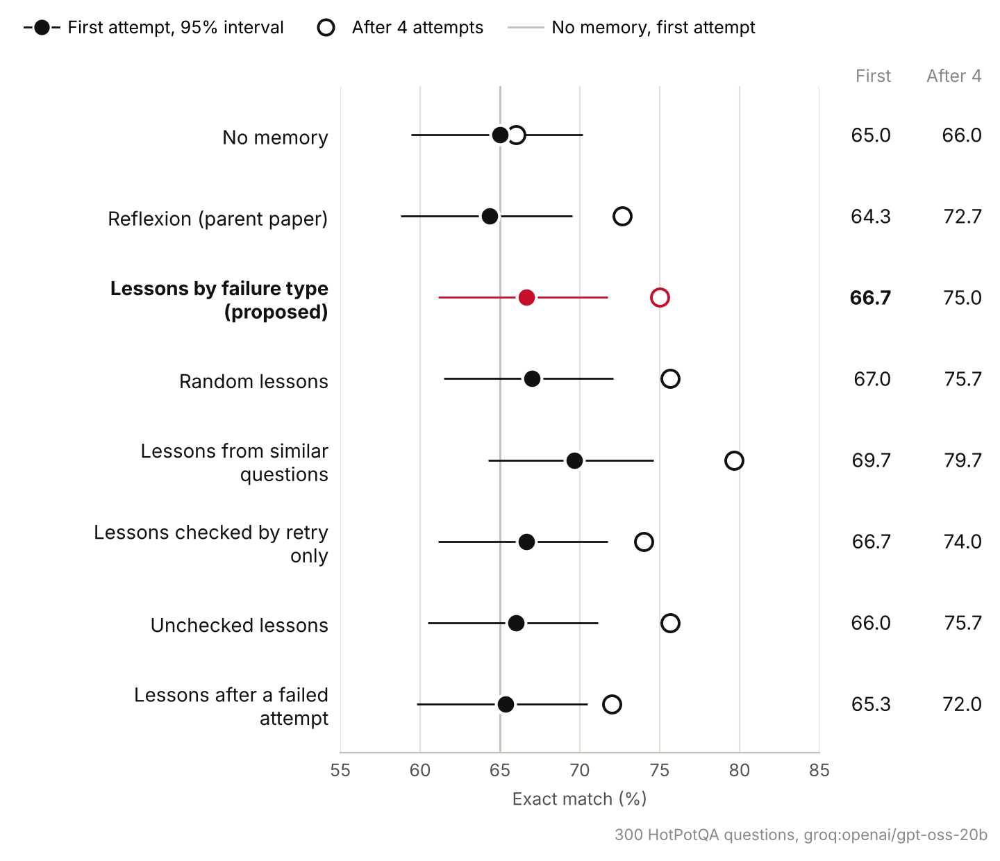

# Reflexion: HotPotQA Mini Reproduction

This repository reproduces the central algorithm from **Reflexion: Language
Agents with Verbal Reinforcement Learning** (Shinn et al., NeurIPS 2023):

1. an **Actor** attempts a question;
2. an **Evaluator** returns exact-match feedback;
3. after a failure, a **Self-Reflection** component writes a verbal lesson;
4. the lesson is stored in **episodic memory** and supplied to the next trial.

The implementation uses a five-question subset of the authors' released
HotPotQA distractor sample. It reports HotPotQA-style exact match (EM), token F1,
and cumulative accuracy after each trial.

## Reproducing the parent paper's HotPotQA result

The paper's HotPotQA experiment (Fig. 4b, "CoT (GT)") gives the agent the
supporting passages and lets it retry each of 100 questions. Without reflection
the share of solved questions stays flat at about 0.61. With reflection it rises
to about 0.75 after a few retries. The `reproduce` command runs those two
conditions on a seeded sample of the test split and prints both curves next to
the paper's values:

```bash
python3 -m pip install -r requirements.txt
export GROQ_API_KEY="your-key"           # console.groq.com
python3 run_experiment.py reproduce --provider groq --n 100 --trials 4
```

It writes `results/reproduction_attempts.csv` (one row per attempt),
`results/reproduction_report.json` (both curves plus the paper's reference
values) and `results/reproduction_curve.png`. Run it with `--provider scripted`
to check the pipeline without an API key; scripted numbers are not results.

As in the paper's CoT (GT) setting, `reproduce` gives the agent only the two
supporting paragraphs (`--context gold`); `--context full` supplies all ten
distractor paragraphs and costs about ten times more tokens.
The baseline condition sends a fresh prompt on every attempt, with no memory and
no trace of earlier attempts, which matches the paper's "CoT (GT) only" line.
The Reflexion condition carries the failed attempt and its reflections forward.
Absolute numbers will differ from the paper because the model is different
(the paper used GPT-4 in 2023); the pattern to look for is a flat baseline and
a rising Reflexion curve. If the baseline already solves more than about 75% of
questions on the first attempt, Reflexion has little to fix: pick a weaker
model with `--model`, or add `--level hard` to sample only the hard questions.

### Results

Model `openai/gpt-oss-20b` on Groq, 100 hard questions from the test split
(seed 0), supporting paragraphs only, up to 4 attempts. Share of questions
solved by the end of each attempt:

| Attempt | Baseline | Reflexion | Paper baseline | Paper Reflexion |
|---|---|---|---|---|
| 1 | 0.66 | 0.65 | 0.61 | 0.61 |
| 2 | 0.66 | 0.71 | 0.61 | 0.69 |
| 3 | 0.67 | 0.72 | 0.61 | 0.69 |
| 4 | 0.67 | 0.72 | 0.61 | 0.70 |

Reflexion recovered 7 of its 35 first-attempt failures (+7 points); the
baseline moved by one question. The paper reports +9 points by its fourth
attempt and +14 after seven. The per-attempt records are in
`results/reproduction_attempts.csv`, the curves in
`results/reproduction_report.json` and `results/reproduction_curve.png`.

A later change to the grading: this model often writes a typographic hyphen or
curly quotes where the dataset has plain ones, and the HotpotQA normalization
counts that as a wrong answer ("Malaysian‑Australian" against
"Malaysian-Australian"). The grader now maps those characters to their keyboard
forms first. The table above is the run as it was graded at the time. Regraded,
the same run reads 0.68, 0.68, 0.69, 0.69 for the baseline and 0.67, 0.74, 0.75,
0.75 for Reflexion.

## Run a real LLM experiment

The live path uses the current OpenAI Responses API:

```bash
python3 -m venv .venv
source .venv/bin/activate
python -m pip install -r requirements.txt
export OPENAI_API_KEY="your-api-key"
python run_reflexion.py --provider openai --limit 5 --trials 3
```

Use `--model MODEL_ID` or the `OPENAI_MODEL` environment variable to choose a
model available to your account. API calls may cost money. Never expose the API
key in a recording or commit it to GitHub.

Useful options:

```text
--mode compare|baseline|reflexion
--provider scripted|openai
--limit N
--trials N
--data PATH
--output PATH
```

## Novel approach: lessons that carry over to new questions

Reflexion uses a reflection once, on the question that produced it, and then
drops it. This project changes one block of the agent, the memory. After a
failed question the reflection is rewritten as a short lesson, the lesson is
tested, and the lessons that pass are shown to the agent before it answers a
different question. The Actor, the Evaluator, the reflection step and the model
are the same as in the reproduction above.

### How a lesson is made and checked

1. The agent runs the parent paper's loop on 1,000 hard training questions, up
   to three attempts each. After a wrong answer it is told only that the answer
   was wrong.
2. Every failed first attempt gets a failure type (rules first, then the model)
   and a lesson, written by the same model from its own attempts and
   reflections. The lesson has two parts: a diagnosis of that attempt, and a
   general fix that starts with "When the question asks for". The dataset's
   answer is never in a prompt. If a retry was accepted, the lesson writer sees
   the answer the agent found by itself.
3. A lesson is dropped if its fix quotes the answer or names something from its
   own question.
4. Check 1, the same question. The question the lesson came from is attempted
   again from scratch with only the lesson in the prompt. The lesson passes if
   the answer is now right.
5. Check 2, other questions. A lesson that passed is placed alone in the prompt
   for 100 development questions that produced no lessons. It is kept if it
   turns more wrong answers right than right answers wrong.

| Stage | Lessons |
|---|---|
| First attempts that failed, out of 1,000 | 357 |
| Left after the two screens | 312 |
| Passed check 1 | 50 |
| Passed check 2 (the lesson pool) | 8 |

Check 2 also showed how easily this agent's answers move. A single lesson
changed about 9 of the 100 development answers: on average 3.8 turned right and
5.1 turned wrong. The eight lessons that were kept each still broke between one
and six answers that had been right. `results/memory.json` holds every lesson,
its checks, and the reason it was kept or dropped.

### Techniques compared

Every condition answers the same questions with the same model and the same
supporting paragraphs. Conditions with lessons show three of them.

| Condition | Lessons the agent reads | What it tests |
|---|---|---|
| `no_memory` | none, fresh prompt on every attempt | baseline |
| `reflexion` | none, reflects and retries | the parent paper |
| `failure_memory` | checked lessons, chosen by failure type | the proposed method |
| `random_memory` | checked lessons, chosen at random | whether the choice of lesson matters |
| `similarity_memory` | checked lessons from the most similar questions | another way to choose |
| `retry_memory` | lessons that passed check 1 only | whether check 2 is needed |
| `unvalidated_memory` | lessons that passed no check | whether the checks are needed at all |
| `late_memory` | the proposed lessons, shown only after a failed attempt | whether timing matters |

`failure_memory` takes lessons from the same kind of question (bridge or
comparison), one per failure type starting with the most common type. Within a
type it takes the lesson whose own question shares the most words with the new
one. Every condition except `no_memory` keeps Reflexion's reflect and retry
step.

### Results

Model `openai/gpt-oss-20b` on Groq at temperature 0, hard questions from the
test split, supporting paragraphs only, up to 4 attempts. EM is exact match.
First sample, 300 questions (seed 0):

| Method | Lessons | First attempt EM | 95% CI | First attempt F1 | Fixed | Broken | p | EM after 4 attempts | Added tokens | Seconds |
|---|---|---|---|---|---|---|---|---|---|---|
| No memory | 0 | 65.0% | 59.4% to 70.2% | 0.779 |  |  |  | 66.0% | +0 | 0.30 |
| Reflexion (parent paper) | 0 | 64.3% | 58.8% to 69.5% | 0.776 | 0 | 2 | 0.500 | 72.7% | +5 | 0.28 |
| Lessons by failure type (proposed) | 3 | 66.7% | 61.2% to 71.8% | 0.802 | 16 | 11 | 0.442 | 75.0% | +189 | 0.45 |
| Random lessons | 3 | 67.0% | 61.5% to 72.1% | 0.796 | 15 | 9 | 0.307 | 75.7% | +193 | 0.35 |
| Lessons from similar questions | 3 | 69.7% | 64.2% to 74.6% | 0.819 | 23 | 9 | 0.020 | 79.7% | +177 | 0.42 |
| Lessons checked by retry only | 3 | 66.7% | 61.2% to 71.8% | 0.797 | 16 | 11 | 0.442 | 74.0% | +175 | 0.31 |
| Unchecked lessons | 3 | 66.0% | 60.5% to 71.1% | 0.786 | 15 | 12 | 0.701 | 75.7% | +186 | 0.33 |
| Lessons after a failed attempt | on retries | 65.3% | 59.8% to 70.5% | 0.782 | 1 | 0 | 1.000 | 72.0% | +4 | 0.30 |



"Fixed" and "Broken" count first attempt answers that changed against the no
memory answer to the same question. p is the exact McNemar test on those two
counts. Added tokens and seconds are per question on the first attempt.

One row stood out, so the five main conditions were run again on 300 new test
questions (seed 1, none shared with the first sample):

| Method | Lessons | First attempt EM | 95% CI | First attempt F1 | Fixed | Broken | p | EM after 4 attempts | Added tokens | Seconds |
|---|---|---|---|---|---|---|---|---|---|---|
| No memory | 0 | 65.3% | 59.8% to 70.5% | 0.801 |  |  |  | 66.3% | +0 | 0.29 |
| Reflexion (parent paper) | 0 | 65.7% | 60.1% to 70.8% | 0.802 | 1 | 0 | 1.000 | 73.3% | +0 | 0.28 |
| Lessons by failure type (proposed) | 3 | 67.0% | 61.5% to 72.1% | 0.810 | 16 | 11 | 0.442 | 75.0% | +190 | 0.51 |
| Random lessons | 3 | 65.7% | 60.1% to 70.8% | 0.825 | 10 | 9 | 1.000 | 72.0% | +189 | 0.38 |
| Lessons from similar questions | 3 | 67.0% | 61.5% to 72.1% | 0.817 | 13 | 8 | 0.383 | 75.0% | +179 | 0.54 |

Both samples together, 600 questions:

| Method | Lessons | First attempt EM | 95% CI | First attempt F1 | Fixed | Broken | p | EM after 4 attempts | Added tokens | Seconds |
|---|---|---|---|---|---|---|---|---|---|---|
| No memory | 0 | 65.2% | 61.3% to 68.9% | 0.790 |  |  |  | 66.2% | +0 | 0.29 |
| Reflexion (parent paper) | 0 | 65.0% | 61.1% to 68.7% | 0.789 | 1 | 2 | 1.000 | 73.0% | +2 | 0.28 |
| Lessons by failure type (proposed) | 3 | 66.8% | 63.0% to 70.5% | 0.806 | 32 | 22 | 0.220 | 75.0% | +189 | 0.48 |
| Random lessons | 3 | 66.3% | 62.5% to 70.0% | 0.811 | 25 | 18 | 0.360 | 73.8% | +191 | 0.36 |
| Lessons from similar questions | 3 | 68.3% | 64.5% to 71.9% | 0.818 | 36 | 17 | 0.013 | 77.3% | +178 | 0.48 |

What the numbers say:

- The proposed method raised first attempt EM by 1.7 points in both samples,
  with 16 answers fixed and 11 broken each time. Over 600 questions that is 32
  fixed and 22 broken (p = 0.22), so the gain is not statistically significant.
  First attempt F1 rose by 0.016 (95% bootstrap interval -0.001 to 0.033).
- After four attempts the proposed method solved 75.0% in both samples, against
  72.7% and 73.3% for Reflexion. Over 600 questions it gained 32 questions and
  lost 20 (p = 0.13).
- Choosing lessons by failure type was not better than choosing them at random
  from the same pool: 66.8% against 66.3% on the first attempt (p = 0.76). On
  F1 the random lessons were slightly ahead, 0.811 against 0.806.
- Lessons from similar questions had the best first sample (69.7%, p = 0.02)
  and a smaller gain in the second (67.0%). Over 600 questions that is 68.3%
  with 36 fixed and 17 broken (p = 0.013), and 77.3% after four attempts. Read
  this row with two cautions. It is one of six lesson conditions, so a low p
  value turns up by chance more often than its face value says. And the pool
  has only eight lessons, whose questions share almost no words with a new
  question, so this condition showed nearly the same three lessons every time
  (L0029 for 297 of the first 300 questions, L0045 for 281, L0060 for 173). Two
  of those tell the agent to answer with the name or the single word alone.
  So the row is evidence about that set of three lessons, and it says little
  about similarity search.
- Lessons help on comparison questions and do little on bridge questions. Over
  600 questions the proposed method fixed 7 comparison answers and broke 1
  (73.6% to 78.3%). On bridge questions it fixed 25 and broke 21. In the first
  sample its fixes split evenly between a longer answer ("Brooklyn" to
  "Brooklyn, New York") and a shorter one ("Maurice Ravel" to "Ravel"), and 7
  of its 11 breaks made a right answer longer ("West Palm Beach" to "West Palm
  Beach, Florida").
- The two checks did not show up in accuracy at this sample size. Lessons that
  passed only check 1 scored the same as the checked pool on the first attempt
  (66.7%), and lessons with no check scored 66.0%.
- Showing the lessons only after a failed attempt changed nothing: 72.0% after
  four attempts, against 72.7% for Reflexion.
- Three conditions share the same first attempt prompt (no memory, Reflexion,
  lessons after a failed attempt). They scored 65.0%, 64.3% and 65.3% in the
  first sample, so repeated runs move by about one point.
- Three lessons add about 190 tokens per question to the first attempt (472 to
  660). Building the memory took 8,734 model calls and 5.1 million tokens,
  about $0.58 at Groq's list price.

The sealed validation split has not been opened. It is kept for the final test
of the method.

### Run it

```bash
export GROQ_API_KEY="your-key"           # console.groq.com
COMMON="--provider groq --level hard --context gold --workers 8 --tpm 235000"
FIVE="no_memory,reflexion,failure_memory,random_memory,similarity_memory"

python run_experiment.py pilot    $COMMON --n 40
python run_experiment.py build    $COMMON --n 1000 --dev-n 100
python run_experiment.py evaluate $COMMON --n 300 --trials 4 --conditions all --label rules
python run_experiment.py evaluate $COMMON --n 300 --trials 4 --conditions $FIVE --label rules \
    --seed 1 --exclude-attempts results/eval_attempts.csv \
    --memory results/memory.json --out-dir results/replication

# No API key needed from here on.
python run_experiment.py analyze --attempts results/eval_attempts.csv
python run_experiment.py analyze --attempts results/eval_attempts.csv results/replication/eval_attempts.csv \
    --conditions $FIVE --out results/pooled/eval_report.json
```

Add `--layout column` to the last command to also draw the figure at the width
of one column of a two column paper (`results/pooled/comparison_column.png`).

`--workers 8 --tpm 235000` suit Groq's paid tier, which allows 250,000 tokens
per minute. On the free tier leave both out and expect a much longer run.
`evaluate` saves after every condition, and `--resume` continues a run that was
interrupted. `--provider scripted` runs the whole pipeline offline to test it.
Scripted numbers are not results. The sealed validation split can only be
loaded with `--final-validation`. A Colab version is in
`notebooks/failure_memory_experiment.ipynb`.

Every model attempt is a row in a CSV: the condition, question type,
prediction, exact match, F1, failure type, the lessons shown, the reflection,
token counts and response time. `analyze` rebuilds every table and figure above
from those files.

Two notes on the saved run. The main evaluation was run in two steps, the two
baselines first and then `--conditions all --resume`. And the screen for
lessons that name something from their own question was added after the checks
had run, so it was applied to the saved lessons (17 dropped, listed in
`results/memory.json`). A new build applies it before the checks.

## Full dataset split

The official HotpotQA distractor training pool contains 90,447 labeled
questions. It is divided with seed 42 and stratified by question type and
difficulty:

- Training: 54,268 questions (60%) in two compressed JSONL shards
- Testing: 18,089 questions (20%)
- Validation: 18,090 questions (20%)

The files are in `data/hotpotqa_splits/`. Keep
`validation_unseen/validation.jsonl.gz` sealed until development and testing are
complete. See `split_manifest.json` for the source links, counts, and SHA-256
checksums. Run `scripts/split_hotpotqa.py` to reproduce the split from the two
official Parquet source shards.

## What matches the parent paper

- repeated trials on HotPotQA question-answering tasks;
- context-grounded chain-of-thought Actor prompts;
- exact-match environment feedback;
- language-model-generated reflection after unsuccessful trials;
- task-local verbal memory injected into later Actor prompts;
- baseline and Reflexion experimental conditions.

## What is intentionally smaller or modernized

- Five released sample items are included instead of the paper's 100-question
  experimental sample, keeping a classroom run quick and inexpensive.
- The live provider uses the supported Responses API instead of the authors'
  pinned 2023 `openai==0.27.4`/`langchain==0.0.162` stack.
- The offline provider is solely a reliable demonstration and test fixture.
- This code does not claim to reproduce the paper's exact headline scores. Model
  versions, sampling, API behavior, and the smaller sample differ.

## Repository map

```text
run_reflexion.py                         recording-friendly entry point
src/reflexion_reproduction/core.py      Actor/evaluator/reflection/memory loop
src/reflexion_reproduction/providers.py offline and live model providers
src/reflexion_reproduction/prompts.py   Actor and reflection prompts
src/reflexion_reproduction/metrics.py   exact match and token F1
data/hotpotqa_mini.json                  five released HotPotQA sample items
data/hotpotqa_splits/                    full 60/20/20 split and manifest
scripts/split_hotpotqa.py                deterministic dataset splitting tool
tests/test_reflexion.py                  automated regression tests
run_experiment.py                        failure-memory experiment entry point
src/reflexion_reproduction/data.py      split loader (validation sealed)
src/reflexion_reproduction/failure_memory.py  labels, lessons, the two checks, retrieval
src/reflexion_reproduction/pipeline.py  conditions, CSV logging, analysis
tests/test_failure_memory.py             tests for the extension
src/reflexion_reproduction/reproduction.py  baseline vs Reflexion curves next to the paper's
tests/test_reproduction.py               tests for the reproduction command
src/reflexion_reproduction/parallel.py  parallel workers and token pacing
src/reflexion_reproduction/figures.py   comparison figure
notebooks/failure_memory_experiment.ipynb  Colab walkthrough
results/reproduction_*                   the reproduction run
results/memory.json                      every lesson, its checks, why it was kept or dropped
results/build_attempts.csv               every attempt made while building the memory
results/eval_attempts.csv                every attempt of the first sample, with its report and table
results/replication/                     the same for the second sample
results/pooled/                          both samples together
```

## Suggested recording sequence

For the novel approach:

1. Show this repository and the Results section above.
2. Open `src/reflexion_reproduction/failure_memory.py` at `build_memory`: the
   Reflexion loop on a lesson question, the lesson, the two screens, check 1
   and check 2.
3. Open `src/reflexion_reproduction/pipeline.py` at `CONDITIONS` and
   `src/reflexion_reproduction/core.py` at `run_trial`: the lessons enter the
   Actor prompt and nothing else in the loop changes.
4. In a terminal at the repository root, run `python3 -m pytest -q`.
5. Run a small live comparison:
   `python3 run_experiment.py evaluate --provider groq --n 20 --level hard --context gold --trials 2 --conditions no_memory,reflexion,failure_memory --label rules --out-dir /tmp/demo --memory results/memory.json`
6. Run `python3 run_experiment.py analyze --attempts results/eval_attempts.csv`
   and keep the comparison table visible.
7. Open `results/comparison.png`, then `results/memory.json` at one kept lesson
   and one rejected lesson.

For the reproduction, see `python3 run_experiment.py reproduce` and the first
Results section.

## Sources and attribution

- Paper: [Shinn et al., NeurIPS 2023](https://proceedings.neurips.cc/paper_files/paper/2023/hash/1b44b878bb782e6954cd888628510e90-Abstract-Conference.html)
- Authors' code and released sample: [noahshinn/reflexion](https://github.com/noahshinn/reflexion)
- Dataset paper: [HotPotQA](https://arxiv.org/abs/1809.09600)
- Current live-client pattern: [OpenAI Responses API](https://developers.openai.com/api/reference/resources/responses/methods/create)

The reproduction code is MIT licensed. Please retain the citations above when
sharing the project.
